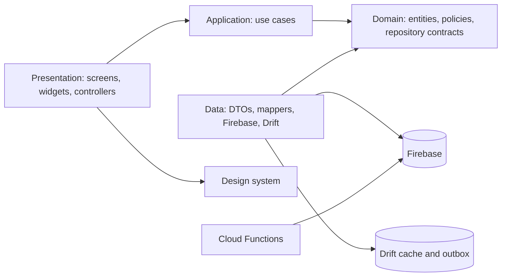
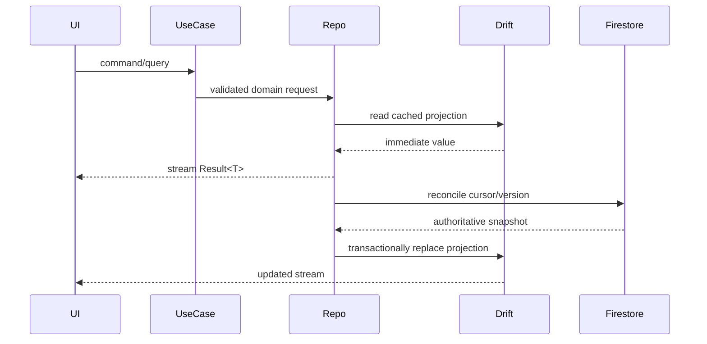
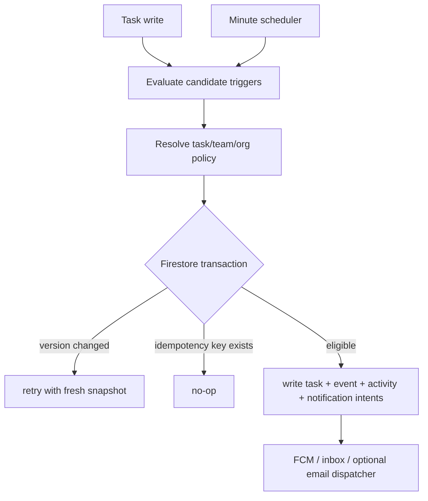

# Architecture

## Shape

Relay is a feature-first Clean Architecture application. Dependency direction is `presentation -> application -> domain <- data`. Domain libraries import Dart only. Flutter, Firebase, Drift, and notification SDKs are adapters at the edge.

## Runtime Data Flow

Writes are optimistic and durable: the repository applies a local transaction, stores an outbox command with its base version and field mask, then returns `Result.success`. `OutboxProcessor` retries with capped exponential backoff. Version conflicts pass through `ConflictResolver`; disjoint field masks merge automatically and overlapping edits become a user-visible conflict.

## Server-Authoritative Escalation

The Dart evaluator is a pure preview and fixture-test mirror. It never authorizes or writes an escalation.

## Module Map

- `lib/core`: `Result`, sealed failures, clock, logging, environment, constants, sanitization, extensions.
- `lib/design_system`: semantic tokens, themes, a11y helpers, reusable atoms and molecules.
- `lib/features/auth`: identity and session.
- `lib/features/organization`: organizations, teams, memberships, policies.
- `lib/features/tasks`: task aggregate, repositories, commands, queries, UI.
- `lib/features/priority`: scoring, calendar, SLA.
- `lib/features/escalation`: evaluator, target resolution, timeline, policy editor.
- `lib/features/notifications`: inbox, permission state, push/local adapters.
- `lib/features/dashboard`: personal and team projections and analytics.
- `lib/features/settings`: profile, availability, preferences, theme.
- `lib/app`: bootstrap, providers, typed router, adaptive shell.
- `functions`: TypeScript escalation and notification authority.

## Error and Time Boundaries

No exception crosses a repository or use-case boundary. Adapters catch SDK exceptions and map them to `Failure`. All time-sensitive code receives a `Clock`; server writes use server timestamps and retain client-observed time only as diagnostic metadata.

## Environments

`dev`, `staging`, and `prod` use separate Firebase projects, app IDs, Remote Config namespaces, and App Check configuration. Values are supplied by generated Firebase options and `--dart-define`; secrets are never committed.

