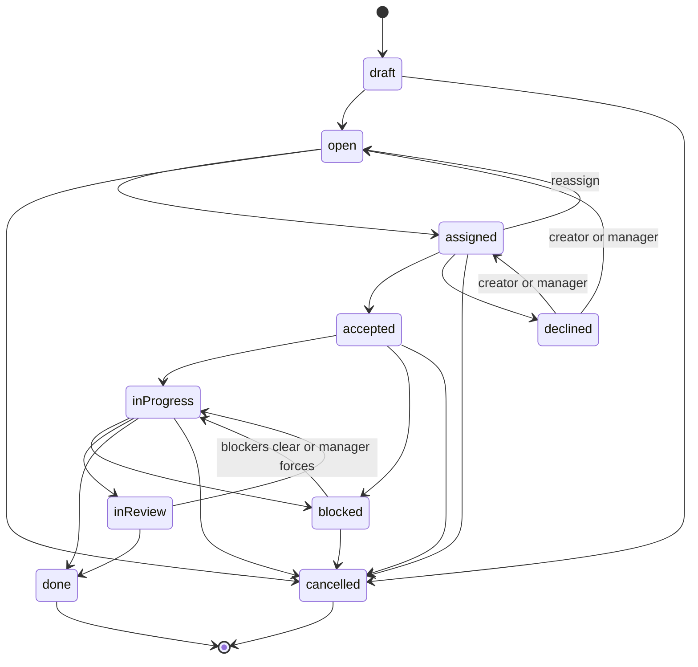

# Task State Machine

`TaskTransitionPolicy.canTransition` is pure and returns a decision with a denial reason. `applyTransition` validates authorization and blockers, creates a new task with an incremented version and relevant timestamps, and returns the matching append-only activity. Illegal edges return `Failure.invalidTransition`.

Done and cancelled are terminal in the normal graph. A manager-only reopen operation is modeled as a distinct command, not an ordinary edge, and always writes an audit entry containing the previous terminal state and reason.

When leaving `blocked`, unresolved dependency IDs prohibit the transition unless `force` is true and the actor has manager permission. Accepting, completing, or clearing the last blocker requests de-escalation; only the server applies the authoritative level change.

